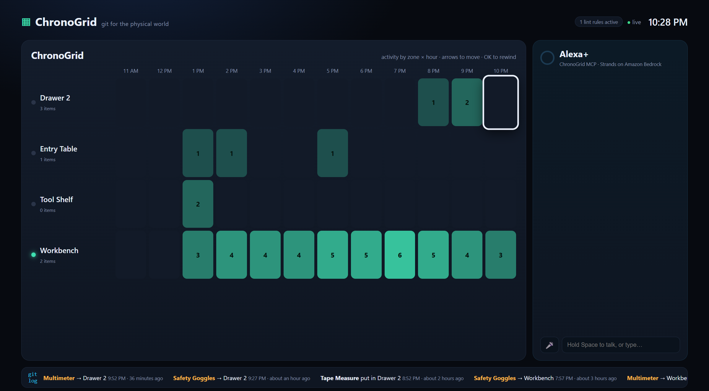
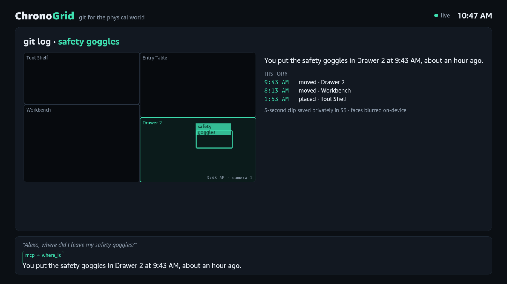
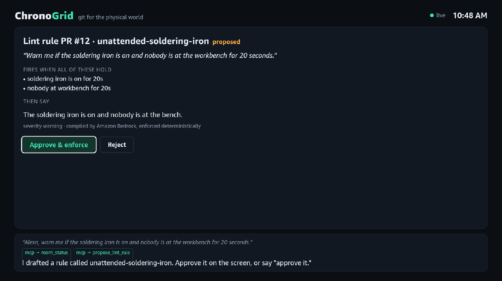
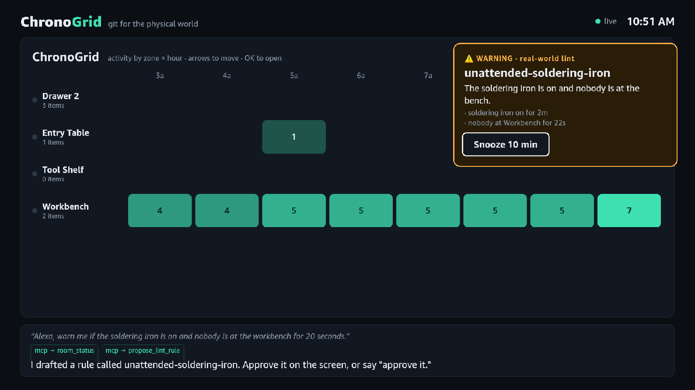
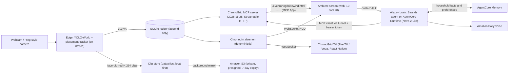

# ChronoGrid: git for the physical world

> "Alexa, where did I leave my safety goggles?"
> *"You put the safety goggles in Drawer 2 at 9:27 PM, about an hour ago."* The screen loops the 5-second moment you set them down, with a box around them.

ChronoGrid gives a home or workshop a **commit history**. An on-device camera pipeline records *what was put where, and when* into an append-only ledger. A **self-hosted MCP server** (spec 2025-11-25, Streamable HTTP) exposes that history to **Alexa+** as git-style verbs. A **deterministic linter daemon** watches for real-world bugs, like a soldering iron left on with nobody at the bench, and slides a warning onto the ambient screen.



**ChronoGrid TV on Fire TV (Vega Virtual Device):** Alexa+ answers "where did I leave my safety goggles?" and the TV jumps to the rewind; a spoken safety rule arrives as a pull request approved with the remote; the linter slides in a hazard card.

| Rewind (`git log`) | Lint rule PR | Hazard alert |
| --- | --- | --- |
|  |  |  |

**Hackathon:** Build, Ship, Shape (Amazon Developer Hackathon 2026)
**Primary track:** Alexa+ (self-hosted MCP server, 2025-11-25, Streamable HTTP, plus a simulated Alexa+ ambient screen), with a native **Fire TV (Vega) companion app**, *ChronoGrid TV*
**Mini challenge:** AWS Builder (Amazon Bedrock AgentCore Runtime + Memory, Strands Agents SDK, Bedrock / Nova 2 Lite, Amazon Polly, Amazon S3)

---

## What it does

| Git verb | Say to Alexa+ | MCP tool | What happens |
| --- | --- | --- | --- |
| `git log` | "Where did I leave the multimeter?" | `where_is`, `object_log` | Spoken answer plus a **rewind MCP App** that loops the placement clip and lets you step through the object's history with the D-pad |
| `git blame` | "Who moved my keys?" | `blame` | When and where it last moved, and whether a person was present (presence only, no identity) |
| `git status` | "What's on the workbench?" | `room_status` | Objects per zone, people present, appliances still on, uncommitted changes |
| `git commit` | "Commit the workbench as clean." | `commit_room` | Snapshots a zone's known-good layout |
| `git diff` | "What changed on the bench since I committed it?" | `room_diff` | Red and green diff: what's missing (and where it went) and what's new |
| `lint` | "Warn me if the soldering iron is on and nobody's at the bench for two minutes." | `propose_lint_rule` → `approve_lint_rule` | Bedrock compiles your words into a **typed rule**, shown as a pull request you approve; a deterministic daemon enforces it |
| `lint --fix` | "I'm on it, snooze that." | `snooze_alert` | Snoozes the hazard card |

### The three engines
1. **Retrospective (the physical git log).** YOLO-World runs on-device and turns camera frames into `placed`, `moved` and `removed` events, each with a bounding box and a 5-second H.264 clip in which faces are blurred.
2. **Predictive (the real-world linter).** *ChronoLint* is a small typed rule language (`appliance_on`, `person_absent`, `object_missing`, `time_window`, `sequence_not_followed`). The language model only writes rules; it never decides whether one fires.
3. **Multimodal delivery.** Alexa+ answers by voice (Amazon Polly) while the TV-style ambient screen shows the matching view: rewind, diff, status, rule PR or hazard HUD. You navigate it with arrow keys and OK/Back like a Fire TV remote.

## Why it matters
- **Makerspaces and school labs:** tool accountability ("who had the oscilloscope last?") and safety (unattended heat sources) without anyone policing the room.
- **Aging in place and caregiving:** "Did Mom turn the stove off?" and "where are her glasses?", answered from evidence instead of guesswork, and enforced by rules the family approved.
- **ADHD and executive function:** pre-flight checks ("your keys aren't on the entry table") and a memory you can actually query.

Cameras already record terabytes of footage nobody watches. ChronoGrid turns that footage into a small, queryable, privacy-preserving **ledger of facts**.

## Architecture



- **One process** (`server/api.py`) serves the MCP endpoint at `/mcp`, REST at `/api`, the screen WebSocket at `/ws`, the MCP App at `/apps`, and the web UI.
- The **Strands agent** connects to `/mcp` as a regular MCP client, exactly as Alexa+ connects to a self-hosted MCP server, so the same server works with Alexa+, Claude, VS Code or any MCP host. In production it runs on **Amazon Bedrock AgentCore Runtime** with **AgentCore Memory** and reaches the home server through a tunnel that exposes only `/mcp`, behind a bearer token. Without AWS it runs in-process.
- **ChronoGrid TV** is a native React Native for Vega app for Fire TV. It subscribes to the same WebSocket, so asking Alexa+ "where are my goggles?" jumps the TV to the rewind view and loops the real clip (W3C Media), a hazard slides in as an alert card, and rule PRs are approved with the remote's OK button.
- **Deterministic boundary:** every tool returns a `say` sentence built from ledger rows. The model is told to speak it rather than invent times or places. Alerts come from `server/rules.py`, never from the LLM.
- **Privacy:** detection runs locally; only events (labels and boxes) and short clips with blurred faces leave the device. Presence is tracked, identity is not. Clips expire after 7 days.

More detail: [docs/architecture.md](docs/architecture.md) · AWS usage: [docs/aws-integration.md](docs/aws-integration.md)

## Try it (for judges)
No camera, Fire TV or Alexa+ device is needed: `-Seed` loads a believable day of workshop history. Seeded events have no video, so their rewind shows the zone map; events the camera records carry a real clip. See [seed versus real history](docs/architecture.md#2-the-camera-builds-the-real-history-the-seed-is-only-a-demo).

1. **The MCP server alone (no AWS account):** run `.\scripts\run.ps1 -Seed` (macOS/Linux: `./scripts/run.sh --seed`), then point any MCP host at `http://127.0.0.1:8787/mcp`, for example `npx @modelcontextprotocol/inspector` (transport: Streamable HTTP). Call `where_is {"object": "safety goggles"}`, `room_diff {"zone": "workbench"}` or `room_status`. Claude Desktop, VS Code and Cursor also render the rewind **MCP App**.
2. **The full Alexa+ experience (AWS credentials with Bedrock in `us-east-1`):** open http://127.0.0.1:8787, type or hold Space and say "Where did I leave my safety goggles?", then "Warn me if the soldering iron is on and nobody's at the bench for 20 seconds", "approve it", and press **H** to switch the iron on.
3. **Fire TV:** see [Run ChronoGrid TV](#run-chronogrid-tv-on-fire-tv-vega) (Vega SDK on macOS/Ubuntu, or WSL2 on Windows).

## Quick start

Requirements: Python 3.11+, Node 18+, AWS credentials with Amazon Bedrock (Nova 2 Lite) and Polly access in `us-east-1`.

```powershell
git clone https://github.com/emarc99/ChronoGrid.git
cd ChronoGrid
python -m venv .venv
.\.venv\Scripts\pip install -e ".[dev]"        # macOS/Linux: .venv/bin/pip
copy .env.example .env                          # optionally set CHRONOGRID_S3_BUCKET
.\scripts\run.ps1 -Seed                         # builds the UI, seeds demo history, starts on :8787
```

Open **http://127.0.0.1:8787**. Hold **Space** to talk (Chrome/Edge), or type. Arrow keys move around the ChronoGrid, **Enter** opens a rewind, **Esc** goes back, **S** snoozes an alert, and **H** toggles the demo "soldering iron" smart plug.

macOS/Linux: `cp .env.example .env && ./scripts/run.sh --seed` does the same (it creates `.venv` if needed). Every script in `scripts/` has a bash twin: `run.ps1` / `run.sh` and `tunnel.ps1` / `tunnel.sh`. The Vega scripts in `scripts/vega/` are bash only, since the Vega SDK runs on Linux (WSL2 on Windows) and macOS.

### Add the edge camera
```powershell
.\.venv\Scripts\pip install -e ".[edge]"
.\.venv\Scripts\python -m edge.run                 # webcam 0; or --source demo.mp4 --loop
```
In short ([full explanation](docs/architecture.md#how-it-works-in-plain-words)):
- **It names objects by itself, from a list of words.** YOLO-World looks for the words you give it; the default list covers person, multimeter, safety goggles, pliers, screwdriver, keys, mug, tape measure, soldering iron, scissors, wallet and phone. Change it without code: `--vocab "person,keys,multimeter,glasses,pill bottle"` (keep `person`). Objects not on the list are ignored, and each label is tracked as one object.
- **It builds the real history.** An object that stays put for about a second becomes a *placed* event with a 5-second face-blurred clip, and one that's gone for 4 s becomes *removed*. The server assigns the zone, records a placement in a new zone as *moved*, and each object's events form its `git log`. In production, skip `-Seed` and load only the zones and default rules once with `python -m seed.seed --keep`.
- **Zones** are normalized polygons in [seed/zones.json](seed/zones.json) (the default splits the frame into Tool Shelf, Workbench, Entry Table and Drawer 2). Redraw them to match where your camera points.
- **Clips are saved locally first** in `data/clips/`, then mirrored to S3 in the background when `CHRONOGRID_S3_BUCKET` is set. The screens get a presigned S3 link once the copy is confirmed, and the local file until then.
- **Demo reset** (`POST /api/demo/reset`) wipes camera events too, so reset before recording, not after.

### Connect any MCP host (Alexa+, Claude, VS Code, Cursor)
Endpoint: `http://127.0.0.1:8787/mcp` (Streamable HTTP). To expose it to a cloud host, tunnel it and set `CHRONOGRID_HOST=0.0.0.0`.

```powershell
.\.venv\Scripts\python scripts\mcp_smoke.py
# protocol offered : 2025-11-25
# protocol agreed  : 2025-11-25
# tools: where_is [MCP App ui://chronogrid/rewind.html], object_log, blame, room_status, ...
```

### Run the Alexa+ brain on AgentCore (optional)
```powershell
cd cloud\ChronoGridAlexa; agentcore deploy --yes; agentcore status   # note the runtime ARN
cd ..\..; .\scripts\tunnel.ps1                                        # exposes only /mcp
# .env: CHRONOGRID_AGENT_RUNTIME_ARN=<arn>, CHRONOGRID_MCP_TOKEN=<random>
.\scripts\run.ps1
```
macOS/Linux: `./scripts/tunnel.sh` and `./scripts/run.sh` (the tunnel script downloads `cloudflared` on Linux; on macOS run `brew install cloudflared` first).
Details: [docs/aws-integration.md](docs/aws-integration.md#alexa-brain-on-agentcore).

### Run ChronoGrid TV on Fire TV (Vega)
The TV app lives in [`tv/`](tv/). On Windows, the Vega SDK and Vega Virtual Device run under WSL2 with KVM; [`scripts/vega/`](scripts/vega/) has the setup, boot and deploy scripts:
```powershell
wsl -u root -e env SUDO_USER=<wsl-user> bash scripts/vega/prereqs.sh      # once
wsl -e bash scripts/vega/install-sdk.sh                                    # once
wsl -e bash -l scripts/vega/vvd-up.sh                                      # keep running
wsl -e bash -l scripts/vega/tv-deploy.sh                                   # build + install + launch
```
The app reaches the server at `http://10.0.2.2:8787` (the emulator's host alias); change [`tv/src/config.ts`](tv/src/config.ts) for a real Fire TV.

## Tests
```powershell
.\.venv\Scripts\python -m pytest -q
```
The suite covers the ledger (commit/diff, presence), the ChronoLint evaluator, the linter alert lifecycle, the edge placement tracker, and the MCP tools including the MCP App binding.

## Repository layout
```
server/   ledger, ChronoLint rules + linter daemon, MCP server (+ apps/rewind.html MCP App), FastAPI entry
agent/    Strands + Bedrock "Alexa+" brain (MCP client), AgentCore client, Polly voice
cloud/    AgentCore project: the Alexa+ brain for AgentCore Runtime + Memory (CDK, CodeZip)
edge/     YOLO-World detector, placement tracker, face-blurred clip writer, edge runner
web/      Vite + React ambient screen (MCP Apps host, heatmap, diff/status/rule PR views, HUD)
tv/       ChronoGrid TV: React Native for Vega (Fire TV) companion app
seed/     demo zones and a day of history
scripts/  run and tunnel scripts, MCP protocol smoke test, Vega/WSL setup (scripts/vega)
docs/     architecture, AWS integration, friction log, product feedback, demo script
```

## Built during the hackathon
Everything in this repository was written during the submission window (see the commit history).

## License
[MIT](LICENSE)
