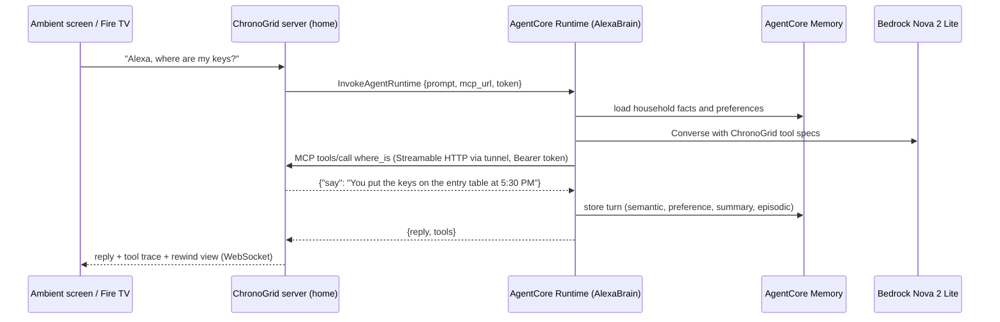

# AWS integration (AWS Builder mini challenge)

| AWS service | Where in code | What it does in ChronoGrid |
| --- | --- | --- |
| **Strands Agents SDK** | [`agent/alexa_agent.py`](../agent/alexa_agent.py) | The Alexa+ brain. `Agent` + `BedrockModel` + `MCPClient(url=".../mcp")` loads ChronoGrid's MCP tools over Streamable HTTP. Uses `SlidingWindowConversationManager`, `S3SessionManager`, and a `BeforeToolCallEvent` hook for the on-screen tool trace. |
| **Amazon Bedrock: Amazon Nova 2 Lite** (`us.amazon.nova-2-lite-v1:0`) | `server/config.py` (`CHRONOGRID_MODEL_ID`) | Interprets voice requests, picks git-verb tools, and **compiles natural-language safety rules into typed ChronoLint rules** via the `propose_lint_rule` tool schema. Answers in about 3 s end to end. Any Bedrock Converse model with tool use can be swapped in via `CHRONOGRID_MODEL_ID` (e.g. Claude Haiku 4.5 once Anthropic access is enabled on the account). |
| **Amazon Polly** (generative, falling back to neural) | [`agent/voice.py`](../agent/voice.py), `/api/tts` | Alexa+'s voice on the ambient screen: replies and spoken hazard announcements. |
| **Amazon S3** | [`server/storage.py`](../server/storage.py), `S3SessionManager` | Private bucket (all public access blocked, SSE-S3 encrypted) for the face-blurred rewind clips. The server saves each clip locally first and mirrors it to `clips/` in the background, so the edge never waits on the network; on startup it re-uploads any clip a restart cut short. The screen, Fire TV app and MCP App get **presigned URLs** (1 hour) once S3 has the clip, and the local copy until then. A **7-day lifecycle expiry** applies under `clips/`. The ledger holds the facts and stores only each clip's file name. The same bucket holds Strands **session memory** under `sessions/`, so the assistant remembers context across restarts and devices. |
| **Amazon Bedrock AgentCore Runtime** | [`cloud/ChronoGridAlexa/app/AlexaBrain/main.py`](../cloud/ChronoGridAlexa/app/AlexaBrain/main.py), [`agent/cloud_brain.py`](../agent/cloud_brain.py) | The production home of the Alexa+ brain. The same Strands agent runs as a serverless AgentCore runtime (`BedrockAgentCoreApp` + `@app.entrypoint`), isolated per session. The local server calls it with `bedrock-agentcore:InvokeAgentRuntime`; the runtime calls back into the household's MCP server over Streamable HTTP. Warm turns take 3–4 s end to end; a keep-warm ping avoids 13–45 s cold starts. |
| **Amazon Bedrock AgentCore Memory** | [`cloud/ChronoGridAlexa/app/AlexaBrain/memory/session.py`](../cloud/ChronoGridAlexa/app/AlexaBrain/memory/session.py) | Long-term memory for the household (`actor_id = household`), with four strategies: **semantic** facts, **user preferences** (how they name things, how long rules should wait), **session summaries**, and **episodic** memory. Wired in through Strands' `AgentCoreMemorySessionManager`. Object locations still come only from MCP tools, never from memory. |
| **AWS CDK / CloudFormation, CloudWatch** | [`cloud/ChronoGridAlexa/agentcore/`](../cloud/ChronoGridAlexa/agentcore/) | `agentcore deploy` synthesizes a CDK stack (runtime, memory, least-privilege execution role) and ships the agent as a CodeZip artifact. Runtime logs and traces land in CloudWatch (transaction search enabled). |

## Setup used
```powershell
$b = "chronogrid-clips-<account-id>"
aws s3api create-bucket --bucket $b --region us-east-1
aws s3api put-public-access-block --bucket $b --public-access-block-configuration BlockPublicAcls=true,IgnorePublicAcls=true,BlockPublicPolicy=true,RestrictPublicBuckets=true
aws s3api put-bucket-lifecycle-configuration --bucket $b --lifecycle-configuration '{"Rules":[{"ID":"expire-clips-7d","Status":"Enabled","Filter":{"Prefix":"clips/"},"Expiration":{"Days":7}}]}'
```
Then set `CHRONOGRID_S3_BUCKET` in `.env`. Without it, clips are served locally and sessions are stored in `data/sessions/`.

## Alexa+ brain on AgentCore



Deploy (AgentCore CLI, `npm i -g @aws/agentcore`, needs `uv` on PATH):
```powershell
cd cloud\ChronoGridAlexa
agentcore deploy --yes            # CDK stack: runtime + memory + IAM role
agentcore status                  # prints the runtime ARN
```
Then run the household side:
```powershell
.\scripts\tunnel.ps1              # Cloudflare quick tunnel -> data\public_url.txt
# .env: CHRONOGRID_AGENT_RUNTIME_ARN=arn:aws:bedrock-agentcore:...:runtime/ChronoGridAlexa_AlexaBrain-...
#       CHRONOGRID_MCP_TOKEN=<random 40 chars>
.\scripts\run.ps1
```
On macOS/Linux use `./scripts/tunnel.sh` and `./scripts/run.sh`.

An idle runtime session gets recycled, and a fresh microVM took up to about 45 s to answer in testing. While the server runs, `CloudBrain` sends a `{"warmup": true}` payload every 4 minutes on the household's session; the runtime answers it without calling the model. The MCP endpoint is **stateless** Streamable HTTP, so the runtime's cached MCP connection keeps working when the home server restarts.

Without `CHRONOGRID_AGENT_RUNTIME_ARN`, the same agent runs in-process ([`agent/alexa_agent.py`](../agent/alexa_agent.py)), so the project still works offline from AWS.

**Exposure is minimal.** Only `/mcp` is reachable through the tunnel, and only with the bearer token. Any tunnelled request (identified by the `cf-ray` header) to the REST API, the UI or the screen WebSocket gets a 404 or a closed socket. See `tunnel_guard` in [`server/api.py`](../server/api.py).

## Minimal IAM policy
```json
{
  "Version": "2012-10-17",
  "Statement": [
    { "Effect": "Allow", "Action": ["bedrock:InvokeModel", "bedrock:InvokeModelWithResponseStream", "bedrock:Converse", "bedrock:ConverseStream"], "Resource": "*" },
    { "Effect": "Allow", "Action": ["polly:SynthesizeSpeech"], "Resource": "*" },
    { "Effect": "Allow", "Action": ["bedrock-agentcore:InvokeAgentRuntime"], "Resource": "arn:aws:bedrock-agentcore:us-east-1:*:runtime/ChronoGridAlexa_*" },
    { "Effect": "Allow", "Action": ["s3:GetObject", "s3:PutObject", "s3:ListBucket", "s3:DeleteObject"],
      "Resource": ["arn:aws:s3:::chronogrid-clips-*", "arn:aws:s3:::chronogrid-clips-*/*"] }
  ]
}
```
This is the policy for the household server. The AgentCore runtime gets its own execution role, generated by the CDK stack.

## Design choice: why detection stays on-device (and not Amazon Rekognition)
Rekognition would be the natural cloud choice for object detection, but a home camera that streams every frame to the cloud is the privacy problem ChronoGrid is trying to avoid. YOLO-World runs locally with an open vocabulary ("multimeter", "pill bottle"), and only events (labels, boxes, presence without identity) plus short face-blurred clips leave the device. AWS handles the parts that benefit from the cloud: language (Bedrock), the agent runtime and memory (AgentCore), voice (Polly) and evidence storage (S3).

## Design choice: deterministic boundary
Bedrock is used where language is ambiguous: interpreting requests and turning "a couple of minutes" into `for_seconds: 120`. Facts and safety decisions are deterministic: locations and times come from the ledger, and alerts come from `server/rules.py`. That keeps a safety feature auditable, which an LLM-judged alert would not be.
