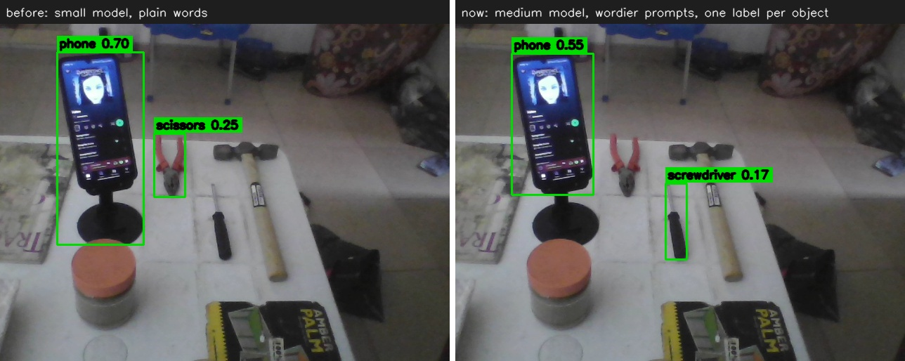

# Friction log

Real friction hit while building ChronoGrid during the hackathon window, in order of occurrence.
Severity: **S1** blocks progress · **S2** costs significant time or forces a design change · **S3** annoyance.

---

### 1. Bedrock: Anthropic model worked once, then failed with "use case details not submitted"
- **Tool:** Amazon Bedrock (Converse / ConverseStream), `us.anthropic.claude-haiku-4-5-20251001-v1:0`
- **Task:** Run the Strands agent on Claude Haiku 4.5.
- **Steps:** `list-inference-profiles` listed the profile, and a one-shot `Agent("Reply with exactly: ok")` call **succeeded**. Minutes later the same model failed inside the agent loop.
- **Expected:** If the model is listed and a call succeeds, it keeps working.
- **Actual:** `ResourceNotFoundException: Model use case details have not been submitted for this account. Fill out the Anthropic use case details form...` on every following call.
- **Severity:** S2 (it would have been S1 mid-demo)
- **Workaround:** Switched the default to **Amazon Nova 2 Lite**, which worked first time with tool use, so the code stays model-agnostic.
- **Suggestion:** Surface the use-case-form requirement in `list-inference-profiles` / `get-foundation-model-availability` (e.g. `"agreementStatus": "USE_CASE_REQUIRED"`), and fail the *first* call consistently instead of letting one through.

### 2. `pip install strands-agents` silently resolved to the 0.0.1 placeholder
- **Tool:** Strands Agents SDK (PyPI)
- **Task:** Install `mcp[cli]` and `strands-agents` together in a fresh Python 3.13 venv.
- **Expected:** The latest Strands (1.6x).
- **Actual:** pip picked `strands-agents==0.0.1` (an empty placeholder) because the latest `mcp` (2.3.0) was outside Strands' supported range, and no error was raised. `from strands import Agent` then failed.
- **Severity:** S2
- **Workaround:** Pin `strands-agents>=1.40`, which let pip backtrack `mcp` to 2.1.1.
- **Suggestion:** Yank 0.0.1 or make it raise on import with a pointer to the real package; publish the supported `mcp` range in the README.

### 3. Strands `FileSessionManager` can't recover a half-written session directory
- **Tool:** Strands Agents SDK, `strands.session.file_session_manager`
- **Task:** Restart the agent process with the same `session_id`.
- **Actual:** After an interrupted cleanup, `session_<id>/agents/...` existed without `session.json`. `read_session` returned `None`, then `create_session` raised `SessionException: Session ... already exists` on every request.
- **Severity:** S3
- **Workaround:** Delete the directory. In production, use `S3SessionManager`.
- **Suggestion:** Treat a directory without `session.json` as corrupt: repair it, or raise a clearer error with the path.

### 4. Getting a per-turn tool trace from a Strands agent
- **Tool:** Strands Agents SDK
- **Task:** Show which MCP tools Alexa+ called on each turn (for the screen and the demo).
- **Actual:** Slicing `agent.messages[len_before:]` returned nothing once `SlidingWindowConversationManager` began trimming history.
- **Severity:** S3
- **Workaround:** `agent.hooks.add_callback(BeforeToolCallEvent, ...)`, which works well.
- **Suggestion:** Expose `AgentResult.tool_calls` (name, input, duration) for the current invocation; it's the first thing every UI needs.

### 5. Alexa+: no way to point a real Alexa+ device or simulator at a self-hosted MCP server
- **Tool:** Alexa+ (MCP integration path)
- **Task:** Test the ChronoGrid MCP server from Alexa+ itself.
- **Actual:** Outside the brand Preview, there's no console, simulator or device setting to register a Streamable HTTP MCP endpoint, so the experience had to be simulated with Strands + Bedrock + Polly.
- **Severity:** S2
- **Suggestion:** An "Alexa+ MCP test console", like the Alexa Skills Kit simulator, that connects to a developer's `/mcp` URL and shows the tool calls and the spoken response. Even text-only would let developers validate tool descriptions against the real Alexa+ planner.

### 6. Alexa+ and MCP Apps: unclear what renders on Echo Show / Fire TV
- **Tool:** Alexa+ / MCP Apps (`io.modelcontextprotocol/ui`)
- **Task:** Ship the rewind card as an MCP App so screen devices show the clip.
- **Actual:** No documentation on whether Alexa+ multimodal devices render `ui://` resources, which CSP and `resourceDomains` apply, or whether video is allowed in MCP App iframes.
- **Severity:** S3 (ChronoGrid falls back to text plus its own screen)
- **Suggestion:** A short "MCP on Alexa+ screens" doc covering supported `_meta.ui` fields, size limits, and media policy.

### 7. Fire TV: Vega Virtual Device on Windows works through WSL2, but only off the documented path
- **Tool:** Vega Developer Tools 0.24.12112, Vega CLI 1.4.5, WSL2 Ubuntu 24.04 (kernel 6.18), Intel i5-1135G7
- **Task:** Run a Vega app on the Vega Virtual Device (VVD) from a Windows laptop with no Vega device.
- **Expected:** The docs list only macOS and native Ubuntu, so we first assumed Windows developers were locked out of the Fire TV track.
- **Actual:** It works, but it took about 45 minutes of trial and error:
  1. `/dev/kvm` is missing in WSL2 until `modprobe kvm_intel` is run and the user is added to the `kvm` group.
  2. The `ppa:deadsnakes` step in the install guide returned HTTP 503. It's only needed for crash symbolication, but the guide presents it as required.
  3. The VVD is killed when the shell that ran `vega virtual-device start` exits, so `start` followed by `run-app` in a new shell fails with "Device not found".
  4. A warm re-boot of a killed instance failed with "failed to access shell" after the 60 s deadline; deleting the instance fixed it.
  5. The `vegaWebview` template builds, but the VVD can't install it: "missing modules ... `/com.amazon.kepler.webview_4@IWebview_4` ... Test your app using a Fire TV Stick instead." The stock `helloWorld` React Native template runs fine.
- **Severity:** S2 (blocked us for an evening; a hosted web app can't be wrapped for the simulator)
- **Workaround:** Our setup scripts are in [`scripts/vega/`](../scripts/vega/).
- **Suggestion:** Document WSL2 + KVM as a supported (or at least known-good) host, make the Python 3.8 step optional, keep the VVD alive independently of the launching shell, and ship the WebView module in the VVD image (or say up front in the template list that `vegaWebview` needs a physical device).

### 8. AgentCore: two CLIs, and an unlisted `uv` prerequisite
- **Tool:** Amazon Bedrock AgentCore CLI `@aws/agentcore` 0.31.1 on Windows 11
- **Task:** Move the Strands Alexa+ brain to AgentCore Runtime with AgentCore Memory.
- **Actual:**
  1. Most blog posts and samples still use the Python `bedrock-agentcore-starter-toolkit` (`agentcore configure/launch`), which is being retired in favour of the npm CLI (`agentcore create/deploy`). The commands share a name but not a workflow, so it's easy to follow the wrong guide.
  2. CodeZip packaging shells out to `uv`, which isn't mentioned as a prerequisite; the deploy failed until `uv` was on `PATH`.
  3. `agentcore create` printed a "folder already exists" message but did create the project.
  4. The first deploy took about 8.5 minutes (CDK bootstrap plus stack), with no indication of which step was slow.
- **Severity:** S3
- **Suggestion:** Check for `uv` up front with an install hint, add a migration note at the top of the starter-toolkit README, and show per-resource progress during the first deploy.

### 9. Fire TV: the Vega Virtual Device window under WSLg only repaints while the mouse moves over it
- **Tool:** Vega Virtual Device (same setup as #7), shown through WSLg on Windows 11
- **Task:** ChronoGrid TV redraws when a WebSocket push arrives (someone asks Alexa a question), with no remote input.
- **Expected:** The new screen shows up as soon as the app renders it.
- **Actual:** The guest renders (our app logs the new state), but the "Vega Virtual Device" window keeps showing the old frame until the real mouse moves over the TV picture. Moving over the remote panel does nothing. Synthetic `WM_MOUSEMOVE`/`SetCursorPos` doesn't help either, and a background `SendInput` nudger only worked some of the time. We spent about two hours chasing what looked like an app bug (animation loops, the media component) before finding out it was the display path. A video surface makes it worse: its last frame can stay on screen after the app has already moved on, so a screenshot may show video that isn't playing any more. Minimizing and restoring the window forces a full redraw.
- **Severity:** S2 (any push-driven or ambient TV app looks broken in the simulator)
- **Workaround:** Move the mouse over the TV picture after each update. We do that while recording the demo.
- **Suggestion:** Make the VVD present frames on its own timer, or document the quirk under "Known issues" for WSL hosts.

### 10. Fire TV: W3C Media clip playback on the Vega Virtual Device
- **Tool:** `@amazon-devices/react-native-w3cmedia` 2.3.4-rn-83 on the VVD
- **Task:** Loop the 5-second MP4 "rewind" clip inside ChronoGrid TV.
- **Actual:** It works, after three surprises (and a first attempt we abandoned because #9 hid the result):
  1. The build reports an `ERROR` that the library version "is not part of its `kepler-compatibility.json`", yet the app builds, installs and plays. It's only a warning, but it reads like a hard failure.
  2. Playing a second clip after leaving the first failed with `gst_kepler_video_sink_change_state ... Failed to create session ID`: the previous player was still tearing down. We now wait for the old player's `deinitialize()` before creating a new one.
  3. `loadedmetadata` never reached our listener, so we poll `videoWidth`/`videoHeight` to place the bounding box over the letterboxed video.
- **Severity:** S3
- **Workaround:** As above; the TV falls back to the zone map if playback errors.
- **Suggestion:** A minimal "play an MP4 on the VVD" sample that switches between clips, and a note on releasing a player before creating the next.

### 11. Fire TV: a large WebSocket message arrives as several `onmessage` events
- **Tool:** React Native for Vega `WebSocket` on the VVD
- **Task:** Receive a ~3 KB JSON screen update (it carries a presigned S3 URL) from our server.
- **Actual:** The app got two `onmessage` events, neither of which was valid JSON (`JSON Parse error: Unexpected end of input`, then `Unexpected character: e`). Browsers always deliver a complete text message per event, so the TV silently ignored every rewind that had a clip.
- **Severity:** S2 (silent data loss with standard WebSocket code)
- **Workaround:** Buffer chunks until the text parses as JSON (`tv/src/api.ts`).
- **Suggestion:** Deliver whole messages, as the WebSocket API specifies, or document the frame size limit.

### 12. Edge vision: YOLO-World on a live laptop webcam couldn't name our hand tools
- **Tool:** YOLO-World v2 (`ultralytics`), all three sizes we could run on a laptop CPU: `yolov8s-worldv2`, `yolov8m-worldv2`, `yolov8l-worldv2`
- **Task:** Record our own clips: a phone, red-handled pliers, a black screwdriver and a wooden-handled lump hammer laid on a white table, filmed live by the laptop webcam (640x480) in a dim room at night.
- **Actual:** Only the phone was labelled reliably. Live, with the original small model and plain words, the pliers and the hammer came out as **"scissors"** and the screwdriver was never labelled. We then benchmarked one still of the table across models, wordings and input sizes (`scripts/bench_detector.py`):

  | Model (CPU time per frame) | Phone | Pliers | Screwdriver | Hammer |
  | --- | --- | --- | --- | --- |
  | small, plain words (~0.2 s) | ✓ | "scissors" | missed | "scissors" |
  | small, wordier prompts | ✓ "smartphone" 0.59 | "red pliers" 0.30, but "scissors" 0.23 on the same object | "smartphone" 0.19 (wrong) | "hammer with wooden handle" 0.16 |
  | medium, wordier prompts (~0.4 s) | ✓ 0.71 | ✓ "red pliers" 0.45 | ✓ but weak, 0.11 | missed; the hammer prompt fired on the pliers (0.19) and screwdriver (0.14) instead |
  | large, plain words (~0.8 s) | ✓ | "pliers" 0.12 vs "scissors" 0.11 | ✓ 0.19 | missed; "mug" 0.41 on a chair in the background |
  | large, wordier prompts | ✓ | ✓ "red pliers" 0.56 | hammer prompt 0.37 (wrong) | hammer prompt 0.22 on the hammer, but 0.39 on the pliers |

  A daytime retake of the same desk shows the same problem. Left: the original setup calls the pliers "scissors" and misses the screwdriver and hammer. Right: the tuned setup finds the phone and, weakly, the screwdriver, but this time misses the pliers that "red pliers" caught at night, and still misses the hammer ([raw photo](images/desk.jpg)):

  

  A larger input (960 px) roughly doubled the time without helping (the medium model's phone score fell from 0.71 to 0.17). No combination labelled all four tools, and the hammer was never the top label on the hammer. 16 Pexels stock clips told the same story with the medium model: phones, mugs and real scissors were right, but pliers and hammers came out as "scissors" (up to 0.85), a hammer as "pliers" (0.42), keys as "phone" (0.36) and a screwdriver as "scissors".
- **Severity:** S2 (we couldn't record our own props for the demo)
- **Workaround:** The edge now defaults to the medium model, lets a wordier prompt record a plain label (`"red pliers=pliers"`), keeps one label per object (class-agnostic NMS) and gives thin tools a lower confidence bar. For the demo video we replay the stock clips that were labelled correctly through the unchanged edge pipeline (`edge.run --source clip.mp4`, one vocabulary per shot); every label, clip and S3 upload in the video is produced live by ChronoGrid.
- **Suggestion:** For tools, open-vocabulary models need better light, a closer camera, a short fine-tune on the household's own objects, or a second opinion from a multimodal model on the object crop when a placement is detected.
